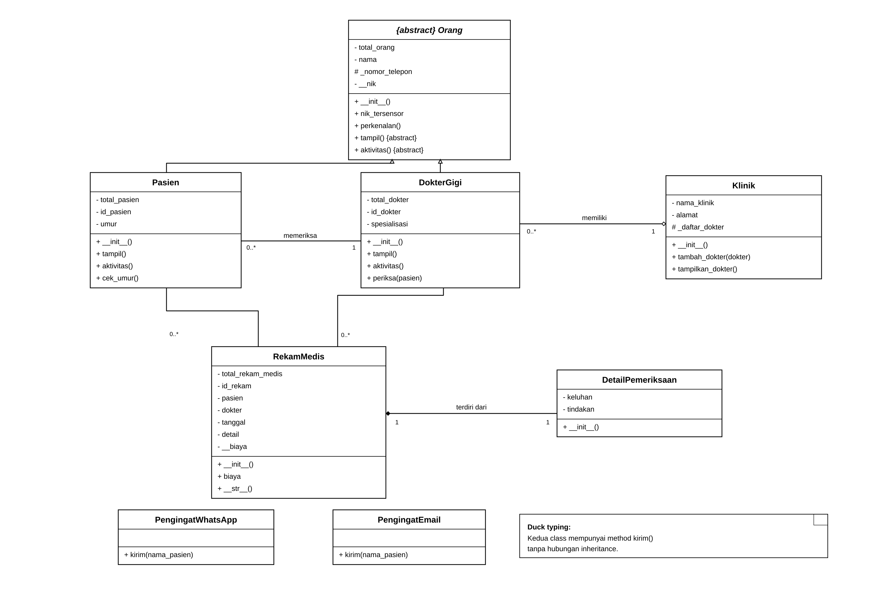
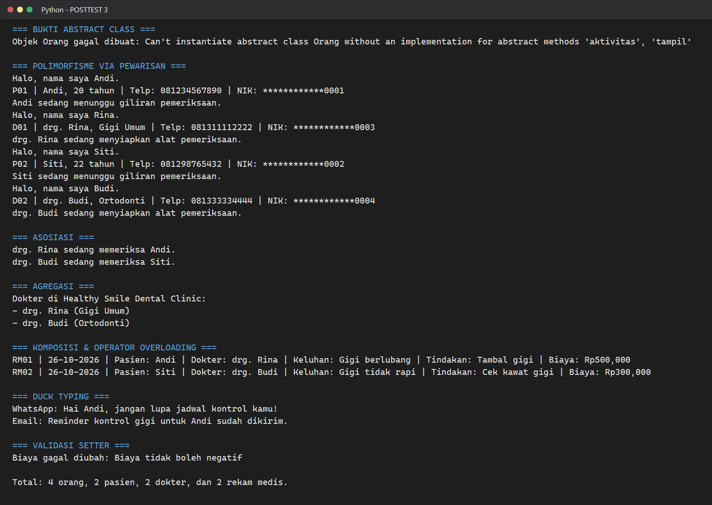

# Dental Medical Record - Posttest 3

Project ini adalah next level dari sistem **Healthy Smile Dental Clinic** di
posttest sebelumnya. Flow-nya masih dibuat simple, tapi sekarang sudah ada
abstract class, polymorphism, duck typing, operator overloading, dan tiga jenis
relasi antarkelas. Basically, makin proper tanpa dibuat overcomplicated.

## Class Diagram



Diagram di atas nunjukin struktur class dan relationship yang dipakai di dalam
program, mulai dari inheritance sampai asosiasi, agregasi, dan komposisi.

### Relasi yang Dipakai

1. **Asosiasi — `DokterGigi` ke `Pasien`**  
   Method `periksa()` menerima objek `Pasien` sebagai parameter. Dokter cuma
   interact dengan pasien saat pemeriksaan dan tidak menyimpannya sebagai bagian
   dari objek dokter.

2. **Agregasi — `Klinik` ke `DokterGigi`**  
   Objek dokter dibuat di luar `Klinik`, lalu dimasukin lewat `tambah_dokter()`.
   Jadi, kalau objek klinik hilang, objek dokternya masih bisa exist sendiri.

3. **Komposisi — `RekamMedis` ke `DetailPemeriksaan`**  
   `DetailPemeriksaan` dibuat langsung di dalam constructor `RekamMedis`, bukan
   dikirim dari luar. Itu kenapa detailnya dianggap bagian yang fully owned oleh
   satu rekam medis.

## Abstraksi

`Orang` sekarang menjadi abstract class dengan `ABC`. Class ini punya dua
abstract method, yaitu `tampil()` dan `aktivitas()`, yang wajib di-implement oleh
`Pasien` dan `DokterGigi`.

Selain itu, ada method konkret `perkenalan()` yang langsung dipakai bareng oleh
semua subclass. Di awal program juga ada `try-except TypeError` buat prove kalau
`Orang` memang nggak bisa dibuat jadi objek secara langsung.

Konsep inheritance dari posttest sebelumnya masih stay:

- `Pasien` dan `DokterGigi` memanggil `super().__init__()`.
- `Pasien` punya atribut unik `id_pasien` dan `umur`.
- `DokterGigi` punya atribut unik `id_dokter` dan `spesialisasi`.
- `_nomor_telepon` bersifat protected, sedangkan `__nik` dan `__biaya` private.

## Polimorfisme

### Polimorfisme via Pewarisan

Objek `Pasien` dan `DokterGigi` dimasukin ke satu list `daftar_orang`, lalu method
`tampil()` dan `aktivitas()` dipanggil lewat satu loop yang sama. Walaupun nama
method-nya sama, output setiap subclass beda sesuai role masing-masing. No need
buat rantai `if/elif` yang ngecek tipe objek.

### Duck Typing

`PengingatWhatsApp` dan `PengingatEmail` tidak punya hubungan inheritance, tapi
keduanya punya method `kirim()`. Function `kirim_pengingat()` bisa menerima dua
objek itu dan menjalankannya dengan cara yang sama—as long as punya method yang
dibutuhkan, it's good to go.

### Operator Overloading

Class `RekamMedis` meng-overload magic method `__str__()`. Karena itu, objek
rekam medis bisa langsung dikirim ke `print()` dan tampil sebagai summary yang
readable, bukan alamat memori objek.

## Nilai Plus: Open/Closed Principle

Program ini menerapkan **Open/Closed Principle (OCP)** di bagian abstraksi dan
loop polimorfisme. Kalau nanti ada subclass baru seperti `Perawat`, class baru
itu tinggal implement `tampil()` dan `aktivitas()`; loop `daftar_orang` nggak
perlu diubah cara kerjanya. So, program open buat extension tapi closed buat
modifikasi logic yang sudah jalan.

## Screenshot Output



Screenshot ini include bukti bahwa abstract class `Orang` gagal diinstansiasi,
plus output polymorphism, tiga relasi, operator overloading, dan duck typing.

## Cara Menjalankan

Buka terminal di folder `POSTTEST-3`, lalu run:

```bash
python 2509106045-Athasyahri-Syawal-Fahrezy-PT3.py
```

Program langsung menjalankan semua demo requirement tanpa input tambahan, jadi
tinggal sekali run dan semua output bakal kelihatan.
